  

# Desenvolvedor Fullstack

## Sou um **desenvolvedor full-stack** e eu desenvolvo **qualquer ideia sua**, seja ela uma **landing page** ou um **sistema complexo**.
### 🇧🇷 Taubaté / São Paulo - Brasil

Com o tempo, fui desenvolvendo habilidades que complementam o desenvolvimento de software. Aprendi marketing, vendas e design para criar páginas que convertem. Também aprendi a estruturar código e construir sistemas sólidos, que não geram problemas mais tarde. Lendo livros de grandes nomes da área, fui me aperfeiçoando em tudo isso, enquanto isso estava sempre testando e implementando mais a IA até dominar o uso de IA completo no desenvolvimento e acelerar meu trabalho em 100%.

Gosto de criar soluções que não apenas resolvem problemas, mas também escalam, duram e geram valor real. Com uma abordagem orientada a negócios, busco entender as necessidades do cliente e do usuário final para entregar algo que realmente faça a diferença.

Meu foco é pegar aquele problema complexo, quebrá-lo em partes menores e criar uma solução profissional e eficiente.

---

### Quer ver o que eu desenvolvo? Veja meu portfólio [gabrueldev.com](https://gabrueldev.com)

---

## 🚀 Projetos em destaque

### [Sellpy](https://github.com/gabrueldev/Sellpy-Agent)
Assistente financeira no WhatsApp com IA. Você manda "vendi 3 bolos por 90" e ela registra a venda, acompanha suas metas e te lembra dos compromissos. Feita com FastAPI, Claude e a API oficial do WhatsApp, e tem uma demo web para testar no navegador.

### [MagazineAPI](https://github.com/gabrueldev/MagazineAPI)
Reserva de salas que não deixa dois agendamentos se chocarem. API em Django REST com login por token, logs e 29 testes, mais uma tela web para usar tudo sem Postman.

### [AutomacaoAPI](https://github.com/gabrueldev/AutomacaoAPI)
API em Django com verificação de conta por e-mail. O envio roda em segundo plano com Celery e Redis, e o projeto sobe inteiro com Docker Compose.

### [auth-com-email](https://github.com/gabrueldev/auth-com-email)
Cadastro com código enviado por e-mail e login JWT em FastAPI. Os códigos são guardados com hash, expiram em 5 minutos e travam depois de 5 tentativas erradas.

---

## 🌐 Onde me encontrar

  
  
  
  

---

## 🛠️ O que eu sei?

### Frontend

### Backend

### Games

### Cloud, DevOps & Tools

---

## 📊 Status do GitHub

  
  

---

> _"If you have to add a feature, it's a sign that you don't understand the problem."_ — Paul Graham

---

⭐ Se você gostou do meu perfil, me dê uma estrela e me siga para acompanhar meus projetos e conteúdos futuros!

🤝 Tem um projeto em mente, seja ele simples ou maluco? **Me chama.** Sempre aberto a colaborações, parcerias e ideias legais!
